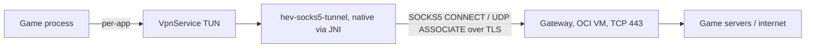

# RFC v0.4: tun2socks + SOCKS5 engine (WireGuard parked)

**Status:** accepted direction
**Owner decision:** WireGuard is parked (not deleted) for now. v0.4 replaces the tunnel transport with a
tun2socks engine that forwards per-app traffic through a SOCKS5 proxy on the gateway, wrapped in TLS.
This is a learning/portfolio project: correctness, honest labeling, and measurements matter more than ship speed.

This complements `docs/SOCKS5_FEASIBILITY.md` (Phase 8): that doc concluded SOCKS5 was only worth it for
TCP games on UDP-blocking networks. The open question then was "is it worth it?" — RFC v0.4 answers
"yes, as the learning exercise and primary transport", and adopts that doc's prototype plan as Phase 4.

## Architecture

## Components

### App side
- **`vpn/Engine.kt`** — extract a transport interface from today's `TunnelController`:
  `start(config)`, `stop()`, `status: StateFlow<EngineStatus>`, `onNetworkChanged()`.
  Two implementations: `WireGuardEngine` (existing code, parked), `SocksEngine` (new, default).
- **`SocksEngine`** — VpnService TUN with the same per-app allow-list (game package + this app).
  Native tunnel: hev-socks5-tunnel (C, JNI wrapper) — candidate list from the feasibility doc
  (`hev-socks5-tunnel`, `xjasonlyu/tun2socks`) to be re-verified during Phase 3.
- **DNS** — fake-IP inside the TUN so connections leave as hostnames through the proxy;
  DNS-over-proxy handler in the engine. DNS leak tests are a Phase 4 gate.
- **Auth** — SOCKS5 username/password. Username = device id, password = short-lived token obtained
  through the existing Supabase JWT + gateway register flow. No new auth path is invented.

### Gateway side
- **New `gateway/socks/` service** — custom asyncio SOCKS5 server (Python) supporting
  CONNECT and UDP ASSOCIATE, terminated behind TLS on TCP 443. Written in-repo as a learning artifact,
  with the hardening borrowed from `gateway/agent.py`: rate limits, connection cap, public-IP-only
  egress checks (anti-SSRF), max peers.
- The WireGuard agent (`gateway/agent.py`, wg port 51820) stays as-is and deployed, unused by default.

## Known trade-offs (kept from the feasibility doc, verbatim commitments)
- TCP over TLS adds a TCP-over-TCP head-of-line blocking risk for latency-sensitive games: measure, do not assume.
- UDP ASSOCIATE still requires UDP to be reachable; on networks that block UDP entirely, UDP games fail
  in both engines. The app must say so honestly (same "UDP may be blocked" message path).
- Userspace TCP/IP stack means higher CPU/RAM than in-kernel WireGuard: measured in Phase 4, with
  explicit thresholds after which WireGuard becomes primary again.

## Phases

| Phase | Scope | Acceptance criteria |
|---|---|---|
| 1 — Engine extraction | `Engine.kt` interface, WireGuard becomes an implementation, zero behavior change | CI green; existing tests pass |
| 2 — Gateway SOCKS5 | `gateway/socks/server.py` (CONNECT + UDP ASSOCIATE, TLS termination notes, auth hook) | Unit tests for handshake/auth/relay; local integration test |
| 3 — SocksEngine + JNI | Native tunnel wired into `SocksEngine`, connect flow swapped | TLS SOCKS5 CONNECT from a device fetches a page through the gateway |
| 4 — Measurements | The prototype-measurement plan from `SOCKS5_FEASIBILITY.md`: connect time, CPU %, RSS, 30-min battery, DNS leak test, UDP echo loss/jitter, Wi-Fi/mobile switch | Numbers published in this doc before calling v0.4 done |
| 5 — Docs & revert path | README/operations update; documented decision on which engine becomes default | Verdict recorded with data |

## Non-goals for v0.4
- No multi-hop, no chaining, no obfuscation beyond TLS.
- No changes to server ranking, smart switching, history, or overlay (Phase 1 must not touch them).
- WireGuard removal is explicitly out of scope: parked, reviewed at v0.5.
